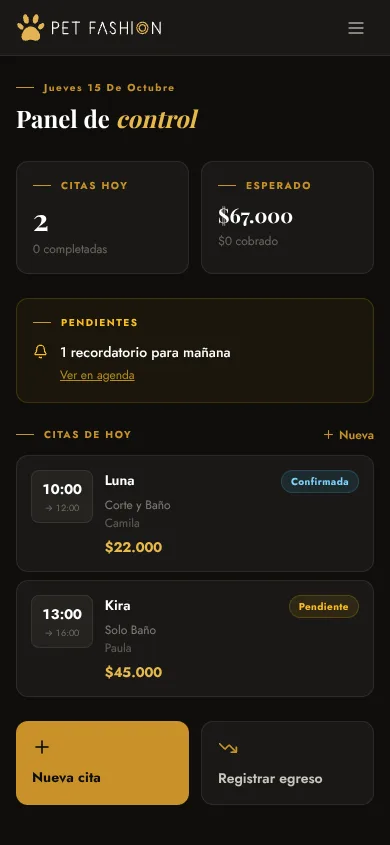
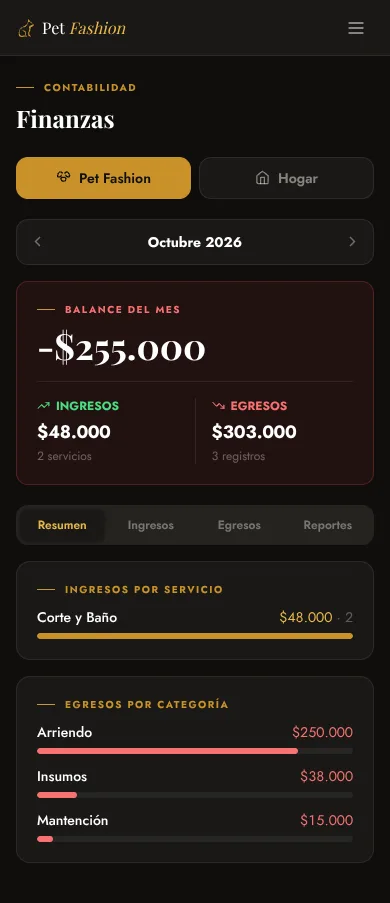

# Pet Fashion Gestión

[](https://github.com/bohaz/petfashion-app-2/actions/workflows/ci.yml)

The app we use to run [Pet Fashion Dog Salon](https://petfashiondogsalon.cl), a dog grooming salon in Isla Negra, Chile: appointments, the dog directory and the finances of the business. Two people use it at the same time from their phones, so changes sync in real time.

It is private (login required) and the interface is in Spanish. The screenshots use sample data.

<p>
  
  
</p>

## Features

- **Today:** the day's appointments, expected and collected income, and pending reminders and review requests.
- **Agenda:** day and month calendar.
- **Dogs:** directory with size, coat, owner, notes and visit history.
- **Pricing rules:** price and duration are worked out from the service and the dog's size and coat, and can be overridden per appointment.
- **WhatsApp messages:** confirmation, reminder and review request from editable templates, opened in WhatsApp (app on phones, WhatsApp Web on desktop). Also adds appointments to Google Calendar.
- **Finances:** monthly balance, income by service, expenses by category, six-month chart, top clients. Household expenses are tracked separately from the business.
- **Real time:** Supabase Realtime pushes every change to the other user without reloading.
- **Installable PWA** on iOS and Android.

## Tech stack

Next.js 15 (App Router) · React 19 · TypeScript (strict) · Tailwind CSS 3 · Supabase (Postgres, Auth, Realtime, row-level security) · Vitest · ESLint · Prettier · GitHub Actions · Vercel

## Architecture

```
src/
├── app/
│   ├── login/              Email and password sign-in
│   └── (app)/              Signed-in area: hoy, agenda, perros, finanzas, mas
├── components/
│   ├── AppProvider.tsx     Data context: initial load, Realtime, CRUD, toasts
│   ├── appointments/       Appointment card, form and detail (WhatsApp actions)
│   ├── dogs/               Dog form and detail
│   ├── finances/           Business and home modules, reports, expense forms
│   ├── layout/             Sidebar, bottom nav, modal manager
│   └── ui/                 Shared UI pieces
├── lib/
│   ├── finance.ts          Month filters, totals, grouping and reports
│   ├── utils.ts            Dates, CLP format, pricing rules, links, templates
│   ├── settings.ts         Merges stored settings with the defaults
│   ├── constants.ts        Services, sizes, categories, default prices
│   ├── types.ts            Domain model
│   └── supabase/           Browser and server clients
└── middleware.ts           Redirects to /login without a session
supabase/schema.sql         Tables, Realtime, row-level security, indexes
```

- **Calculations are pure functions in `lib/`**, separate from React, so they are tested without a browser or a database.
- **One data layer.** `AppProvider` loads everything once, subscribes to Realtime and exposes typed actions. Components never call Supabase directly; the only exceptions are sign-in and sign-out.
- **Dates are local.** Expense dates are Postgres `date` values (`YYYY-MM-DD`). They are parsed as local dates, because `new Date('2026-10-01')` is UTC midnight, which in Chile is still 30 September.
- **Access is enforced in the database.** Row-level security only lets authenticated users read or write; the middleware just redirects.

## Getting started

Requires Node.js 20 or later (see `.nvmrc`) and a Supabase project.

1. **Database.** In the Supabase SQL Editor, run `supabase/schema.sql`.
2. **Users.** In _Authentication → Users_, add the people who will use the app.
3. **Close sign-ups (required).** In _Authentication → Sign In / Providers_, turn off _Allow new users to sign up_. The policies give every signed-in user full access, so with sign-ups open, anyone could create an account with the public anon key and read the client data.
4. **Environment.** Copy `.env.example` to `.env.local` and fill in the project URL and anon key from _Settings → API_.
5. **Run it:**

```bash
npm install
npm run dev        # http://localhost:3000
```

To deploy on Vercel, import the repo and add the same two environment variables.

| Script                        | What it does                                               |
| ----------------------------- | ---------------------------------------------------------- |
| `npm run dev`                 | Development server                                         |
| `npm run build` / `npm start` | Production build and server                                |
| `npm test`                    | Runs the test suite once (`test:watch` to keep it running) |
| `npm run lint`                | ESLint with the Next.js rules                              |
| `npm run typecheck`           | TypeScript without emitting files                          |
| `npm run format`              | Formats the code with Prettier                             |
| `npm run check`               | Lint, types, format check, tests and build (same as CI)    |

## Testing

```bash
npm test
```

45 tests cover the logic in `lib/`, running in the `America/Santiago` time zone:

- Dates: date-only values, month boundaries and local time across the UTC offset.
- Business rules: size from weight, price by service, size and coat, durations.
- Formatting and links: CLP amounts (including negatives), message templates, WhatsApp and Google Calendar links.
- Settings merge with defaults.
- Finance: monthly income and expenses, grouping, top service and clients, six-month summary and average.

CI runs lint, type check, format check, tests and build on every pull request.

## Author

Ricardo Martínez · [Portfolio](https://ricardomartinez.vercel.app/) · [GitHub](https://github.com/bohaz)
